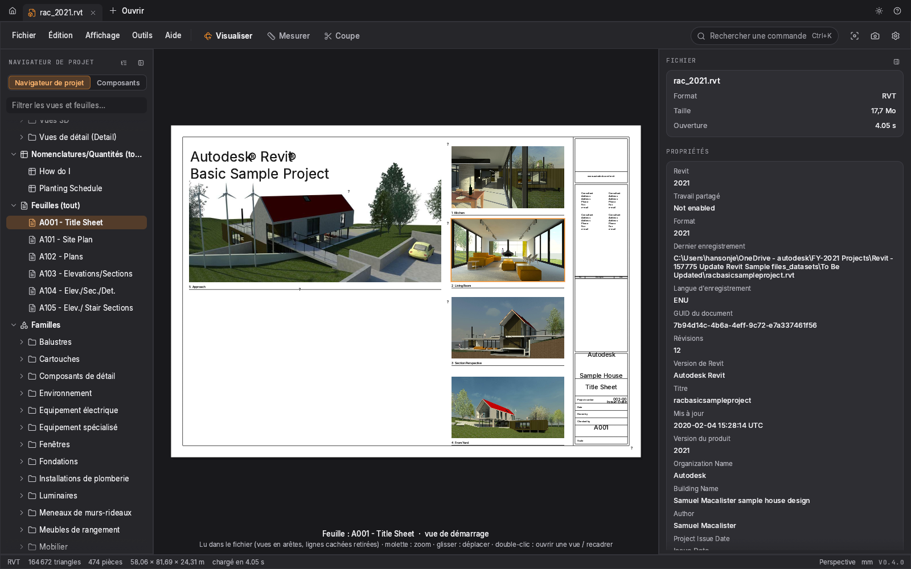
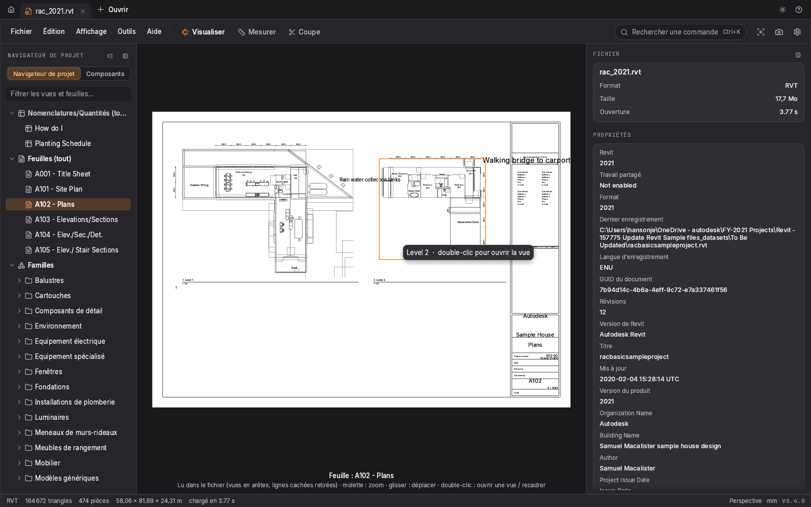
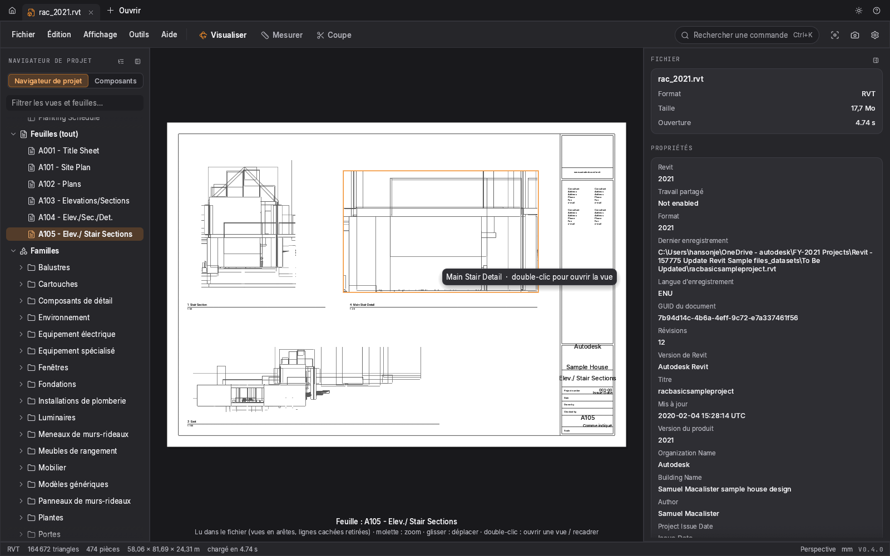
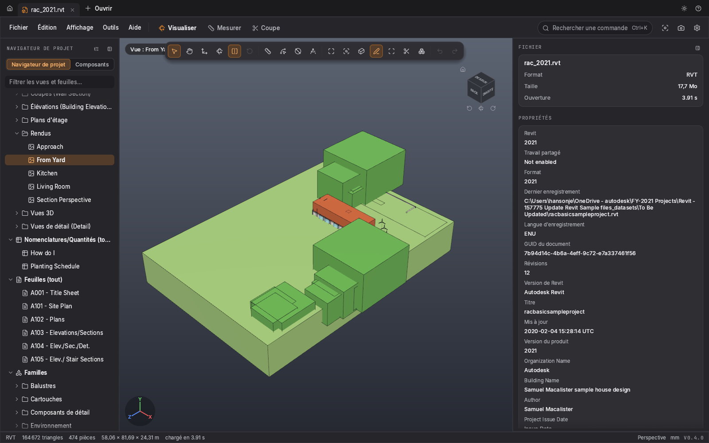
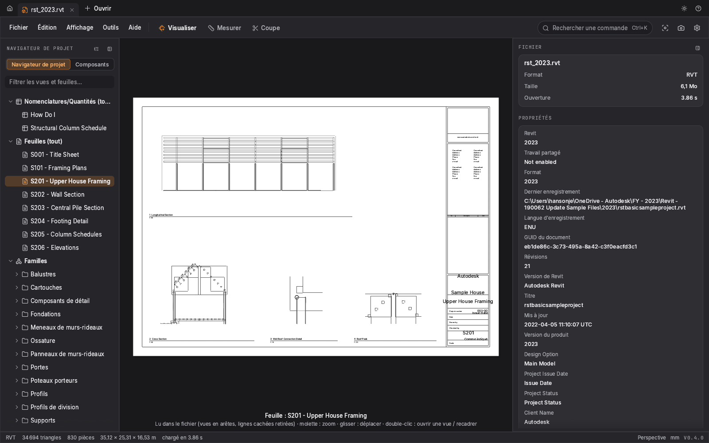

<<<<<<< HEAD
# ModelCraft - la visionneuse 3D ultime (V4)

<p align="center"></p>

> **NDA** : aucune capture de modèles clients / échantillons de test n'est publiée dans ce dépôt.
> Les captures ci-dessous viennent uniquement des **projets d'exemple publics d'Autodesk** (`rac_basic_sample_project`,
> `rst_basic_sample_project`) ouverts dans ModelCraft.

| Feuille de titre (rendus intégrés) | Feuille de plans |
|---|---|
|  |  |
| **Coupes, lignes cachées retirées** | **Vue 3D « From Yard »** |
|  |  |
| **Projet de structure (S201)** | |
|  | |

Visionneuse native, légère et instantanée pour **SolidWorks (`.SLDPRT` / `.SLDASM`), STEP, IGES,
IFC, FBX, glTF/GLB, COLLADA, 3MF, PLY, STL, OBJ, VRML/X3D, USD, 3DS, 3DXML, eDrawings et Revit (boîtes 3D)**, écrite en Rust (wgpu + egui). Un seul `.exe` (ou l'installateur
`ModelCraft-Setup-0.4.0.exe`), sans licence, hors ligne.

Interface dans l'esprit de la suite ArtCraft (disposition reprise de PdfCraft, sous licence
MIT/Apache - voir `NOTICE.md`). ModelCraft est un projet **indépendant**, non affilié.

> ModelCraft ne dépend **ni de SolidWorks ni d'eDrawings** : il lit directement le maillage
> d'affichage enregistré dans les fichiers SolidWorks, et OpenCascade pour STEP/IGES.
> Aucun code d'eDrawings n'a été utilisé.

## Formats

| Format | Extensions | Support | Remarques |
|---|---|---|---|
| SolidWorks | `.sldprt` `.sldasm` | ✅ complet | maillage d'affichage enregistré, arbre d'assemblage, couleurs ; vignette si aucun maillage |
| STEP | `.step` `.stp` | ✅ complet | via OpenCascade 7.8 : maillage des surfaces, arbre d'assemblage, couleurs |
| IGES | `.iges` `.igs` | ✅ complet | via OpenCascade |
| STL | `.stl` | ✅ | binaire et ASCII (unités : mm) |
| OBJ | `.obj` (+ `.mtl`) | ✅ | groupes/objets → composants, couleurs `Kd`, textures `map_Kd` plaquées (UV), normales `vn`, n-gones concaves |
| 3DS | `.3ds` | ✅ | objets et matériaux (couleur diffuse) |
| 3DXML | `.3dxml` | ✅ | représentations tessellées, assemblages |
| eDrawings | `.easm` `.eprt` | ⚠️ partiel | vignette intégrée seulement (géométrie HSF non décodée) |
| Autodesk Revit | `.rvt` `.rfa` `.rte` `.rft` | ⚠️ partiel | boîtes 3D des éléments colorées par catégorie (Revit 2018 à 2026), vignette + informations du fichier et du projet ; pas encore la forme exacte, voir *Limites* |
| IFC (BIM) | `.ifc` `.ifczip` | ✅ complet | IFC2x3 / IFC4 / IFC4x3 via web-ifc : niveaux → éléments, couleurs, transparence (export IFC de Revit, ArchiCAD, Tekla…) |
| FBX | `.fbx` | ✅ | binaire et ASCII via assimp : arbre, couleurs, axe vertical du fichier (pas d'animation) |
| glTF 2.0 | `.gltf` `.glb` | ✅ | nœuds, transformations, couleurs PBR |
| COLLADA | `.dae` | ✅ | unités et axe vertical du fichier |
| 3MF / AMF | `.3mf` `.amf` | ✅ | objets et couleurs (mm) |
| PLY / OFF | `.ply` `.off` | ✅ | ASCII et binaire (mm) ; nuages de points seuls → message clair |
| VRML 97 / X3D | `.wrl` `.vrml` `.wrz` `.x3dv` `.x3d` | ✅ | lecteur VRML intégré (DEF/USE, primitives, couleurs) ; X3D XML via assimp |
| USD | `.usd` `.usda` `.usdc` `.usdz` | ⚠️ partiel | maillages et transformations (tinyusdz) |
| DXF | `.dxf` | ⚠️ partiel | faces 3D et maillages seulement (pas les dessins 2D ni les solides ACIS) |
| Blender | `.blend` | ⚠️ partiel | anciens fichiers 2.7x seulement (assimp). **Blender 2.8+ : Fichier › Exporter › Wavefront (.obj) avec matériaux, glTF 2.0 ou FBX**, puis ouvrir l'export |
| Autres (assimp) | `.x` `.lwo` `.ac` `.ase` `.ms3d` `.md2`… | ⚠️ | via assimp |
| Parasolid | `.x_t` `.x_b` | ❌ | message clair : aucun lecteur libre - exporter en STEP |
| DWG / SketchUp / Rhino | `.dwg` `.skp` `.3dm` | ❌ | message clair : LibreDWG est GPL, SDK SketchUp propriétaire ; exporter en DXF/IFC, DAE/glTF, STEP/OBJ |

### Nouveautés V4

**Navigation et outils**
- **Raccourcis Blender** par défaut (*Paramètres › Navigation › Raccourcis Blender*, désactivable) :
  clic molette = pivoter, `Maj`+clic molette = déplacer la vue, `Ctrl`+clic molette = zoom,
  pavé `1/3/7` (+`Ctrl` = vue opposée), `5` ortho, `2/4/6/8` = tourner de 15°, `9` vue opposée,
  pavé `.` (ou `,`) = **cadrer la sélection**, `Origine` = tout cadrer, `G` déplacer, `R` tourner,
  double-clic molette = tout cadrer. Tous les raccourcis sont listés dans *Aide › Raccourcis*.
- **Outil Panoramique** (main, `Q`) : le clic gauche déplace la vue (translation pure).
- **Déplacer** (`G`) et **Tourner** (`R`) une pièce avec un manipulateur : flèches X/Y/Z, anneaux
  X/Y/Z (`Ctrl` = pas de 15°, angle affiché), ou glisser la pièce pour la faire pivoter librement
  « comme en vrai ». **Réinitialiser** remet la sélection (sinon tout) à sa place.
- **Pivot** du manipulateur (barre en bas de la vue) : centre de la boîte englobante (défaut),
  centre de l'objet, **curseur 3D** (`Alt+clic` / `Alt+glisser` pour le poser sur la surface,
  bouton « Curseur 3D sur la sélection ») ou origine du monde.
- **Annuler / rétablir** (`Ctrl+Z`, `Ctrl+Y` / `Ctrl+Maj+Z`) : déplacements, rotations, éclaté,
  opacités, masquage / isolement.
- **Panneaux latéraux repliables** (boutons en haut des panneaux, `T` / `N`), état mémorisé.
- **Survol synchronisé** : survoler une pièce dans la vue la surligne dans l'arbre, et inversement.

**Affichage**
- Vue **plus claire** (fond gris bleuté, éclairage « phare » qui suit la caméra) en gardant un
  thème sombre lisible ; les anciens réglages par défaut sont migrés automatiquement.
- **Arêtes stables** quel que soit l'angle de vue (plus de clignotement contre les faces).
- **Vue éclatée corrigée** : chaque pièce s'éloigne du centre du modèle en ligne droite, sa
  direction ne s'inverse jamais quand le curseur monte, et à 100 % deux pièces imbriquées
  (étrier dans sa bride) sortent entièrement l'une de l'autre ; fonctionne aussi sur une **pièce
  SLDPRT/STEP d'un seul corps** (éclatement par faces, ≤ 1500 faces). Bouton dans la barre
  d'outils + panneau flottant 0-100 %, lignes d'éclatement discrètes.
- Accueil : grille de formats qui s'adapte à la largeur (plus de texte caché sous « Ouvrir un fichier »).

**Formats et installation**
- **Installateur Windows** (Inno Setup) : menu Démarrer, icône Bureau en option, liste
  d'extensions à cocher (une case par extension), désinstallation propre.
- OBJ + `.mtl` : opacité, **textures plaquées avec leurs UV** (`map_Kd`, découpe par l'alpha), normales et arêtes vives de Blender, n-gones concaves triangulés sans déformation (ear clipping), couleurs `Kd` de Blender converties linéaire → sRGB. Une texture citée par un chemin absolu d'un autre PC (`F:/…/texture.png`) est retrouvée à côté du `.obj`/`.mtl`.

- **Plateau tournant** par défaut (comme Blender : l'axe vertical reste vertical, la vue ne penche jamais) ; *Paramètres › Navigation › Rotation* : Plateau tournant ou Libre (trackball, sans blocage aux pôles). Les anciens réglages « Libre » passent une fois au plateau tournant (V4.1). Boutons « pivoter de 90° » sur le cube de vue.
- **Vue éclatée** : bouton de la barre d'outils, menu Affichage, menu contextuel et Ctrl+K ; panneau flottant (curseur 0-100 %, valeur, animer, réinitialiser). Fonctionne aussi sur une pièce à plusieurs corps (séparation automatique des corps) et sur chaque pièce d'un assemblage ; message si rien n'est éclatable.
- **Opacité de la sélection** appliquée uniquement aux composants / corps sélectionnés.
- **Nombres lisibles** : séparateurs de milliers et unités automatiques (`6 115 613,46 mm²` → `6,12 m²`), désactivables (*Paramètres › Unités automatiques*), respectent le nombre de décimales.
- **Composants d'assemblage introuvables** : recherche élargie, sans tenir compte de la casse - chemin d'origine, arborescence du projet déplacée (dossiers d'origine recréés à côté de l'assemblage), puis tout le dossier du projet (2 niveaux au-dessus, recherche bornée).
- **Revit** : le message propose l'export IFC (Fichier › Exporter › IFC), désormais lisible par ModelCraft.

## Utilisation (Windows)

**Installateur** : lancez `dist\ModelCraft-Setup-0.4.0.exe` (sans droits admin, installé pour
l'utilisateur courant). Il crée l'entrée du menu Démarrer (ModelCraft + scanner) et propose une
**case par extension** à associer (SolidWorks, STEP, IGES, 3DXML, eDrawings, IFC cochés ; STL,
OBJ, FBX, glTF… décochés car souvent déjà ouverts par un autre logiciel). Désinstallation :
*Paramètres Windows › Applications*.

**Version portable** : copiez `dist\modelcraft.exe` où vous voulez (ex. `C:\Outils\ModelCraft\`). Aucune DLL.

- **Ouvrir** : bouton **+ Ouvrir** / `Ctrl+O`, glisser-déposer (un dossier déposé est
  *épinglé* sur l'accueil), ou `modelcraft.exe "F:\chemin\piece.step"`. Plusieurs fichiers
  s'ouvrent dans des **onglets** (clic molette = fermer ; clic droit = fermer / recharger /
  afficher dans l'explorateur / copier le chemin).
- **Accueil** : formats pris en charge, **dossiers épinglés** (liste des modèles du dossier),
  **récents** avec chemin et taille (clic droit : ouvrir / afficher dans l'explorateur /
  copier le chemin / épingler le dossier / retirer).
- **Associer les extensions** : *Paramètres → Général → Associations de fichiers → Associer*
  (ou `modelcraft.exe --associate`). Ajoute ModelCraft à « Ouvrir avec » pour SLDPRT, SLDASM,
  STEP, IGES, STL, OBJ, 3DS, 3DXML, EASM, RVT, RFA - utilisateur courant (HKCU), sans droits admin.
- Chargement en arrière-plan dans une **fenêtre de progression** : nom et taille du fichier,
  étape, octets lus / total, temps écoulé, bouton **Annuler**.

### Gros fichiers (plusieurs centaines de Mo)

Le chargeur SolidWorks est **en flux et à mémoire bornée** :
- le fichier reste projeté en mémoire (mmap) ; seul le flux `DisplayLists` est lu ;
- au-delà de 128 Mo décompressés, il est décodé **directement depuis le décompresseur**, en deux
  passes (1 : statistiques ; 2 : construction du maillage pré-alloué), sans jamais garder le flux
  décompressé ni la liste des faces en mémoire ;
- un **budget de sommets** est calculé selon la mémoire disponible (2 M à 40 M) ; au-delà, le
  maillage est **simplifié pour l'affichage** (regroupement de sommets sur grille) et un
  avertissement l'indique - le fichier n'est jamais modifié ;
- les allocations sont faillibles : en cas de manque de mémoire, message clair au lieu d'un plantage.

Mesures (fichier synthétique de 836 Mo, 60 M sommets, 1,4 Go décompressés) : chargé en ~17 s,
pic mémoire ~1,8 Go (simplifié à 12,5 M sommets) ; ~2,9 Go en affichage exact.

Variables d'environnement : `MODELCRAFT_MAX_VERTICES=100000000` (budget de sommets ; plus haut =
plus exact, plus de mémoire), `MODELCRAFT_STREAM=1` (force le décodage en flux même pour les petits fichiers).

### Diagnostic de chargement : `--diag`

```powershell
Start-Process -Wait "C:\chemin\modelcraft.exe" -ArgumentList '--diag','"F:\chemin\gros.SLDPRT"','--diag-out',"$env:USERPROFILE\Desktop\diag.txt"
Get-Content "$env:USERPROFILE\Desktop\diag.txt"
```
Charge le fichier sans interface et écrit un rapport horodaté (vidé ligne par ligne, donc utile
même en cas de plantage) : système, mémoire, liste des flux du conteneur, étapes, mémoire toutes
les 2 s, résultat (CHARGÉ / ÉCHEC / PANIQUE), statistiques du maillage. Par défaut :
`%APPDATA%\ModelCraft\diag-<nom>.txt`. Codes de sortie : 0 ok, 1 erreur de lecture,
2 fichier invalide, 3 panique. En cas de plantage de l'application : `%APPDATA%\ModelCraft\crash.log`.

### Outils d'assemblage (visionneuse uniquement, rien n'est enregistré)

- **Déplacer** un composant avec le manipulateur (flèches X/Y/Z), réinitialiser.
- **Opacité** par composant et globale, mode transparent.
- **Vue éclatée** (curseur 0-100 %, lignes d'éclatement).
- Accessibles depuis le panneau *Assemblage*, le menu *Outils*, le clic droit et la palette Ctrl+K.

### Menus, palette, menus contextuels

- Barre de menus **Fichier / Édition / Affichage / Outils / Aide** avec raccourcis.
- **Ctrl+K** : palette de recherche de toutes les commandes et des fichiers récents.
- Clic droit **dans la vue 3D** : masquer / isoler / zoom sur la sélection, afficher tout,
  ajuster, vues standard, outils de mesure, projection, arêtes, boîte, coupe, grille, copier
  les dimensions, capture PNG.
- Clic droit **dans l'arbre** : masquer, isoler, afficher tout, zoom sur, copier le nom.

### Mesures (mode **Mesurer**)

| Outil | Résultat |
|---|---|
| Boîte englobante | L × l × h en surimpression (`B`), copiable (`Ctrl+Maj+C`) |
| Distance | entre deux points (accrochage sommets / milieux), avec ΔX ΔY ΔZ |
| Arête | longueur d'une arête |
| Diamètre | Ø d'un perçage / cylindre (ajustement sur la face) |
| Angle | entre deux faces |
| Face | surface de la face sélectionnée |
| Volume / surface | du modèle, dans le panneau Dimensions |
| Coupe | plan de coupe X/Y/Z réglable (`X`) |

Sélection de faces et de composants avec surbrillance ; le panneau de droite liste les mesures.

### Souris et clavier (navigation « Blender » par défaut, modifiable dans les paramètres)

| Action | Commande |
|---|---|
| Pivoter | clic molette (ou clic gauche) + glisser |
| Déplacer la vue | `Maj`+clic molette, clic droit, ou outil **Panoramique** (`Q`) + clic gauche |
| Zoom (vers le curseur) | molette (inversible), `Ctrl`+clic molette |
| Tout cadrer · cadrer la sélection | `Origine` / `F` / double-clic molette · pavé `.` / `,` |
| Vues (pavé numérique ou rangée du haut) | `1` face · `3` droite · `7` dessus · `Ctrl+1/3/7` opposées · `0` iso · `9` vue opposée · `5` ortho · `2/4/6/8` tourner de 15° |
| Déplacer · tourner une pièce | `G` · `R` (re-appuyer pour quitter), `Ctrl` = pas de 15° |
| Annuler · rétablir | `Ctrl+Z` · `Ctrl+Y` / `Ctrl+Maj+Z` |
| Masquer / isoler / tout afficher | `H` / `I` ou `/` / `Maj+H` ou `Alt+H` |
| Arêtes · boîte · coupe · grille | `E` · `B` · `X` · `Maj+G` |
| Arbre · panneau d'infos | `T` · `P` ou `N` |
| Paramètres · palette · plein écran | `Ctrl+,` · `Ctrl+K` · `F11` |

Styles de navigation : Blender (défaut), SolidWorks, CAO (AutoCAD/Inventor). Avec
« Raccourcis Blender » désactivé, les anciens raccourcis reviennent (`0`-`6` = vues, `G` = grille,
`R` = diamètre).

### Paramètres (`%APPDATA%\ModelCraft\settings.json`)

- **Général** : langue **Français / English** (détection automatique de la langue de Windows),
  thème clair / sombre / système, couleur d'accent, nombre de récents, associations.
- **Affichage** : fond dégradé ou uni, éclairage (studio, doux, contrasté…), couleur par
  défaut, arêtes (on/off, épaisseur, couleur), axes, grille, cube de vue.
- **Navigation** : style, zoom inversé, perspective / orthographique, champ de vision, vue par défaut.
- **Mesures** : unités (mm, cm, m, po), décimales.
- **Performances** : anticrénelage MSAA, qualité du maillage STEP/IGES.
- **Réinitialiser** remet toutes les valeurs par défaut.

Options de ligne de commande :
```
modelcraft.exe [fichiers…] [--lang fr|en] [--theme dark|light] [--view iso|front|top|right|back|bottom|left]
               [--size 1600x1000] [--no-edges] [--screenshot capture.png] [--ephemeral]
modelcraft.exe --associate
modelcraft.exe --diag fichier [--diag-out rapport.txt]
```

## Vérifier toute une archive : `swcraft-scan`

```
swcraft-scan.exe "F:\Dev\disneyAutoSorter\Sorted Archive IA" --csv C:\Temp\scan.csv --json C:\Temp\scan.json
```

- Parcourt le dossier récursivement et **n'écrit jamais dedans** (lecture seule, liens non
  suivis, fichiers `~$…` ignorés) ; un rapport ne peut pas être écrit dans le dossier scanné.
- Tous les formats de ModelCraft sont vérifiés (SolidWorks, STEP, IGES, STL, OBJ, 3DS, 3DXML,
  eDrawings, Revit, Parasolid) avec le même code que la visionneuse.
- **Résistant aux plantages** : chaque fichier lourd ou suspect est lu dans un **processus
  séparé** (limite mémoire via Job Object, délai max) ; un plantage d'un lecteur (ex. OpenCascade)
  est noté `crash` et le scan continue. Journal de progression à côté du rapport.
- Double-clic sur `swcraft-scan.exe` : mode interactif (demande le dossier).
- Pour chaque fichier : format, `ok`, `partial` (composants sans maillage), `no_mesh`
  (vignette seulement), `unsupported` (ex. `.x_t`), `error` + faces, triangles, composants,
  temps, message. Résumé par format et temps médian / p95 / max.
- Options : `--threads N`, `--timeout 120`, `--max-size 1G` (`too_large` au-delà),
  `--mem-limit 8G`, `--isolate auto|all|none`, `--log fichier`, `--no-external`, `--quiet`. CSV séparé par `;` avec BOM (Excel FR).

## Compiler depuis les sources

Prérequis : [Rust](https://rustup.rs) ≥ 1.95.

Sous Windows (MSVC ou GNU) :
```
cargo build --release
target\release\modelcraft.exe
```

Sous Linux :
```
sudo apt install libgtk-3-dev libxkbcommon-dev   # boîte de dialogue + clavier
cargo build --release
./target/release/modelcraft fichier.SLDPRT
./target/release/swcraft-scan dossier/ --csv /tmp/scan.csv
```

**STEP / IGES** demandent la fonctionnalité `occt` et une compilation statique
d'[OpenCascade 7.8.1](https://github.com/Open-Cascade-SAS/OCCT) (`BUILD_LIBRARY_TYPE=Static`) :
```
OCCT_INC=/chemin/occt/include/opencascade OCCT_LIB=/chemin/occt/lib \
  cargo build --release -p swcraft -p swcraft-scan --features swcraft/occt,swcraft-scan/occt
```
Sans `occt`, ModelCraft fonctionne pour tous les autres formats et affiche un message pour STEP/IGES.

**FBX, glTF, 3MF…** demandent la fonctionnalité `assimp` (assimp 6.0.2 statique, `ASSIMP_DIR` =
préfixe d'installation contenant `lib/libassimp.a` et `lib/libzlibstatic.a`, compilé avec
`-DBUILD_SHARED_LIBS=OFF -DASSIMP_BUILD_VRML_IMPORTER=OFF -DASSIMP_BUILD_USD_IMPORTER=ON`).
**IFC** demande la fonctionnalité `ifc` : web-ifc compilé en statique (`cmake --build <dossier> --target web-ifc-library`
avec `-DCMAKE_CXX_FLAGS=-Dmapbox=wi_mapbox`), `WEBIFC_SRC=<web-ifc>/src/cpp` et `WEBIFC_BUILD=<dossier de build>`.
Exemple complet : `--features swcraft/occt,swcraft/assimp,swcraft/ifc,swcraft-scan/occt,swcraft-scan/assimp,swcraft-scan/ifc`.

Compilation croisée Linux → Windows (utilisée pour `dist/`, OCCT compilé avec mingw « posix ») :
```
rustup target add x86_64-pc-windows-gnu
sudo apt install mingw-w64
CXX_x86_64_pc_windows_gnu=x86_64-w64-mingw32-g++-posix \
OCCT_INC=/chemin/occt/include/opencascade OCCT_LIB=/chemin/occt-mingw/win64/gcc/lib \
  cargo build --release --target x86_64-pc-windows-gnu -p swcraft -p swcraft-scan --features swcraft/occt,swcraft-scan/occt
```
(`.cargo/config.toml` configure l'éditeur de liens mingw et la CRT statique ; l'icône
et les infos de version sont intégrées via `windres`.)

**Installateur Windows** ([Inno Setup](https://jrsoftware.org/isinfo.php) 6, gratuit) : après la
compilation Windows et la copie des deux `.exe` dans `dist/`,
```
python3 installer/gen_iss.py            # génère installer/modelcraft.iss (extensions lues dans platform.rs, version dans Cargo.toml)
iscc installer\modelcraft.iss           # Windows ; sous Linux : wine "C:\InnoSetup6\ISCC.exe" ...
```
produit `dist/ModelCraft-Setup-<version>.exe`.

Outil de diagnostic : `cargo run --release -p sw-format --example swinfo -- fichier.SLDASM [--streams] [--obj sortie.obj]`.

### Tests

Les fichiers de test (SolidWorks, STEP, maillages…) ne sont **pas** dans le dépôt (`.gitignore`). Les tests
d'intégration lisent le dossier indiqué par `SW_SAMPLES` et sont ignorés s'il est absent :
```
SW_SAMPLES=/chemin/vers/echantillons SW_SAMPLES3=/chemin/vers/revit cargo test --release
```
Fichier synthétique géant pour tester le chargeur : `cargo run --release -p sw-format --example synth_big -- sortie.SLDPRT 60` (millions de sommets).

## Rendu

wgpu (DirectX 12 / Vulkan / OpenGL selon la machine), MSAA réglable, éclairage studio,
arêtes B-rep superposées, fond dégradé, surbrillance de sélection, plan de coupe. Si
l'initialisation GPU échoue, ModelCraft se relance en Vulkan puis en OpenGL. Forcer un
moteur : `WGPU_BACKEND=dx12|vulkan|gl`.

## Limites connues (V4)

- **eDrawings `.easm`** : seule la vignette est affichée (géométrie HSF non décodée).
- **Revit `.rvt` / `.rfa`** : depuis la V7, les **murs droits** (profil modifié compris, ouvertures
  rectangulaires des portes et fenêtres), **sols, plafonds, dalles**, **canalisations, gaines, chemins de
  câbles** et les **solides des familles** (extrusions, révolutions, balayages le long d'un tracé 2D ou
  3D, lissages ; fichiers `.rfa` et familles chargées dans le projet, familles imbriquées comprises,
  placées à leur insertion et recalées sur la boîte Revit quand le type a d'autres cotes) sont affichés avec leur **forme reconstruite** à partir des paramètres stockés (la B-rep
  Revit n'est pas enregistrée dans le fichier). Les autres éléments (une partie des raccords MEP dont
  la forme dépend des cotes du type, murs-rideaux, portes, fenêtres, escaliers, garde-corps, toits,
  murs courbes)
  restent des **boîtes englobantes** colorées par catégorie (fichiers Revit 2018 à 2026, en travail
  partagé ou non, ouverts en lecture seule sans verrou ni synchronisation ; voir
  `docs/rvt-rea-notes.md`). Pour la géométrie complète : exporter en **IFC** depuis Revit, puis
  l'ouvrir dans ModelCraft.
- **Revit, feuilles et vues** : une feuille ouverte depuis le navigateur est dessinée à plat avec son
  **contenu 2D lu dans le fichier** (cartouche : traits, textes et étiquettes remplies avec les
  paramètres de la feuille et du projet, tableau des révisions ; vues placées avec leur titre et les
  **arêtes** des éléments qu'elles voient, découpées par la zone cadrée ; textes ; images des rendus).
  Les **annotations des vues** sont dessinées avec leur style : lignes de détail (épaisseur de plume,
  couleur, motif de ligne), régions remplies (remplissage plein ou **hachures** du motif), **cotes**
  linéaires (lignes d'attache, repères, valeurs dans l'unité du projet), textes et **étiquettes**
  (pièces : nom et numéro ; étiquettes d'éléments : paramètres texte stockés) ; les vues de dessin
  n'affichent que leurs annotations. Les **lignes cachées** des vues placées sont retirées (faces des
  formes reconstruites ; les éléments encore en boîte ne cachent rien). Pas encore : épaisseurs par
  catégorie des éléments du modèle, cotes angulaires / radiales / altimétriques, composants de
  détail, valeurs calculées des étiquettes (surface…). Une vue de plan, coupe, élévation ou 3D s'ouvre avec **sa direction et son
  orientation** (plans pivotés compris) et, quand sa zone cadrée est active, **cadrée dessus**. Ce que
  la vue ne montre pas est **masqué comme dans Revit** : plage de vue des plans (plan de coupe,
  profondeur, niveaux au-dessus / en dessous, plans de plafond regardant vers le haut), zone cadrée,
  découpe lointaine des coupes et élévations, zone de coupe 3D des vues 3D ; les parties coupées sont
  fermées en gris foncé. Les ciseaux de la pastille « Vue : … » affichent ou masquent le reste. La
  navigation 3D (orbite, panoramique, zoom) reste celle de ModelCraft.
- **Parasolid `.x_t`** : non supporté (aucun lecteur libre) ; exporter en STEP. Les fichiers SolidWorks
  sans maillage d'affichage contiennent pourtant leur B-rep Parasolid (flux `Config-N-Partition`,
  « TRANSMIT FILE » binaire) : un lecteur indépendant du format XT (documenté publiquement par
  Siemens) relié à OpenCascade est envisageable, mais c'est un chantier de plusieurs semaines.
- **Flux `MeshData/Config-N-Mesh-*`** (corps maillés des SolidWorks récents, souvent les seuls
  présents dans les très gros fichiers issus de scans ou d'imports STL) : décodés en flux continu quand
  `DisplayLists` est vide (12,8 M triangles lus en ~8 s sur un SLDPRT de 447 Mo). Seule la première
  configuration est lue et les couleurs par corps ne sont pas encore reprises.
- **Blender `.blend`** : seuls les anciens fichiers 2.7x passent (via assimp) ; le format interne
  de Blender 2.8+ change à chaque version. Exporter en OBJ (+ `.mtl`), glTF ou FBX.
- **DWG, SketchUp, Rhino** : non pris en charge (voir `NOTICE.md`).
- SolidWorks : seul le maillage d'affichage enregistré est utilisé (pas de recalcul B-rep) ;
  un fichier sans données graphiques n'affiche que sa vignette.
- Les messages d'erreur des lecteurs de fichiers restent en français dans l'interface anglaise.
- Mesures sur les maillages (STL/OBJ/3DS) : pas de diamètre exact (pas de faces analytiques).
- Pas d'export (STEP, STL…) ni d'annotations sauvegardées : visionneuse uniquement.

## Licence

MIT pour le code de ModelCraft. Code d'interface adapté de PdfCraft (MIT/Apache-2.0),
icônes Lucide (ISC), polices Inter et JetBrains Mono (OFL), OpenCascade (LGPL-2.1) :
détails dans [`NOTICE.md`](NOTICE.md).
=======
# ModelCraft
>>>>>>> 5acfdbd (Initial commit)
