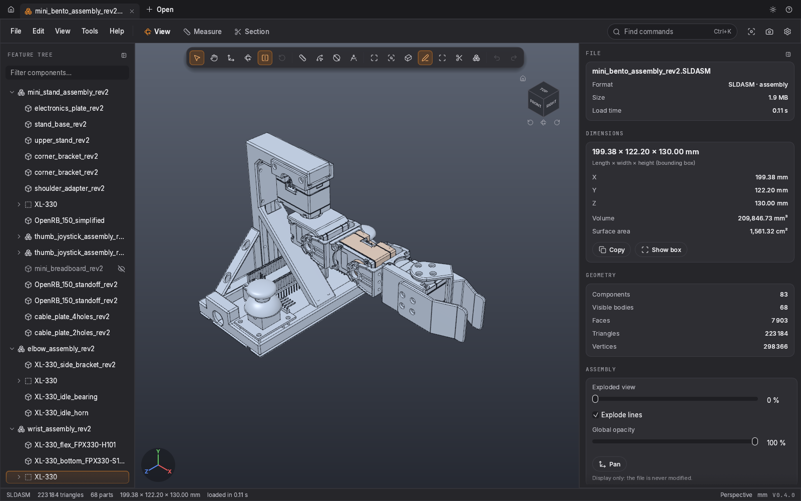
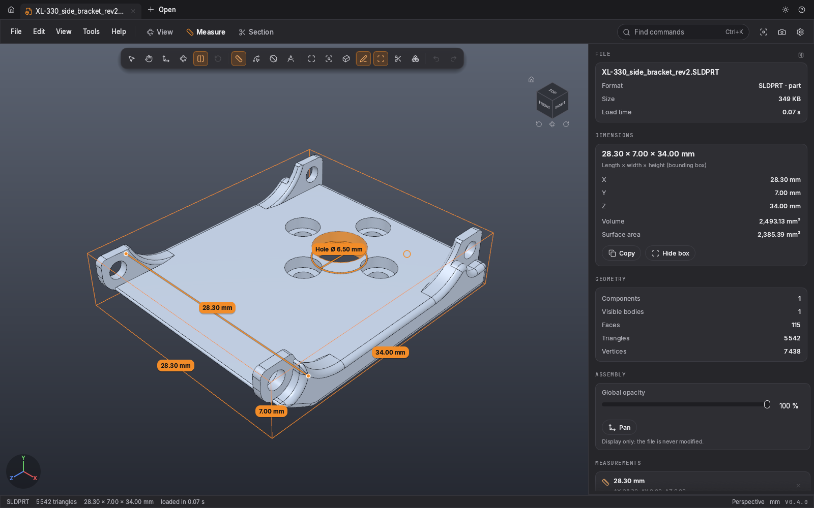
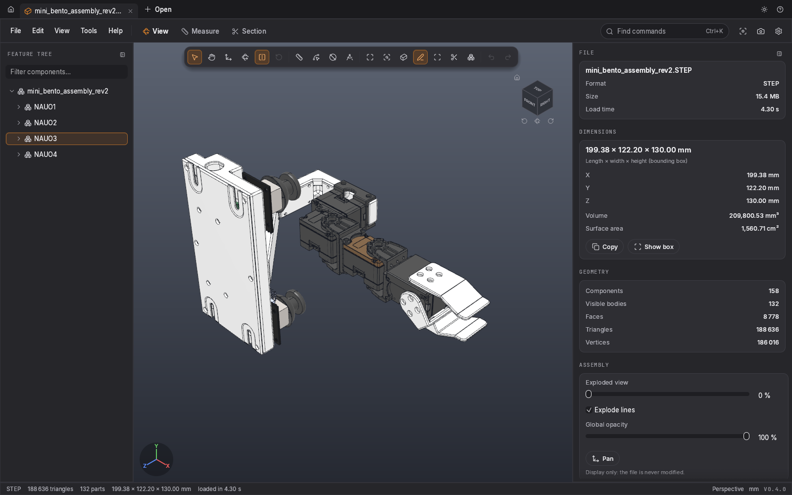
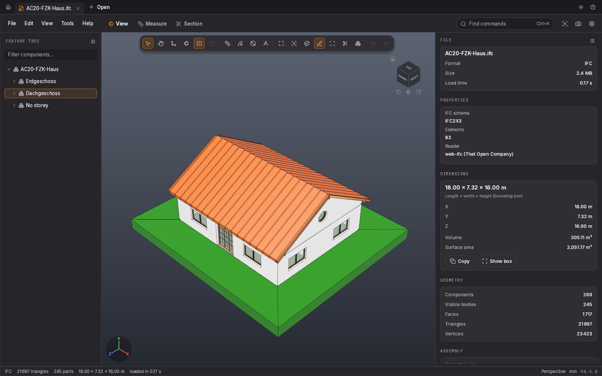
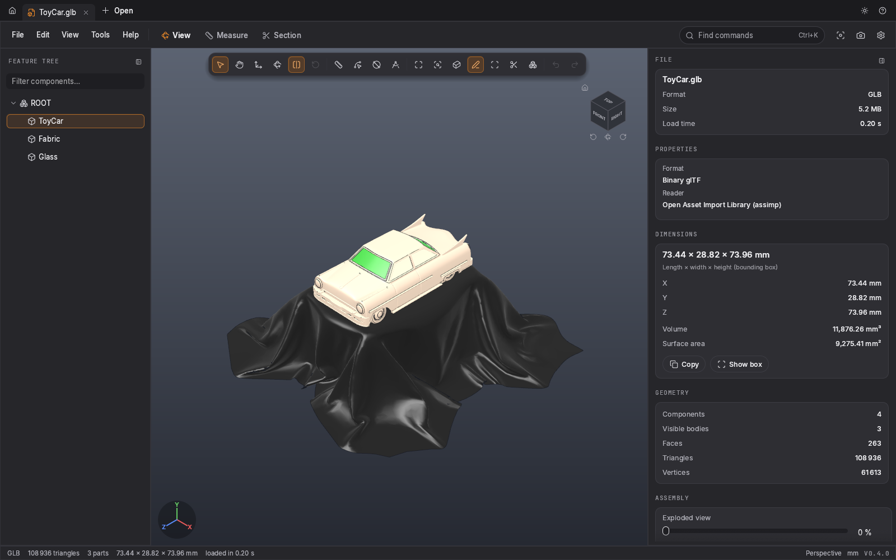
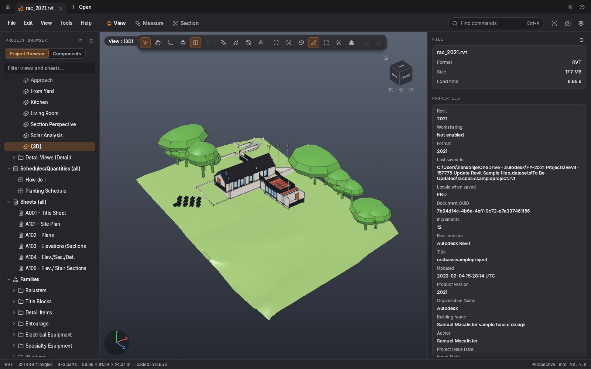
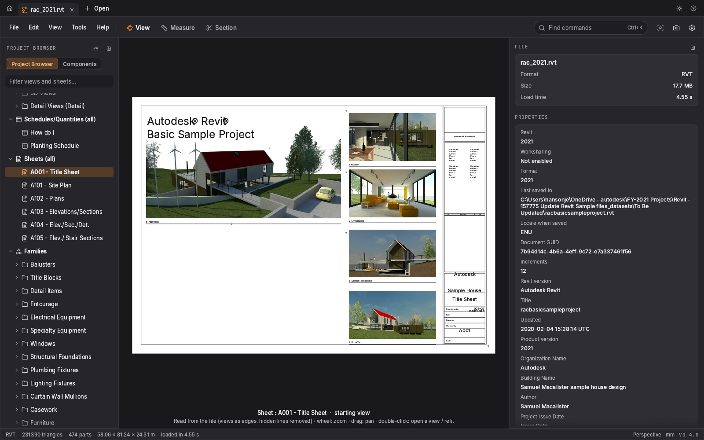
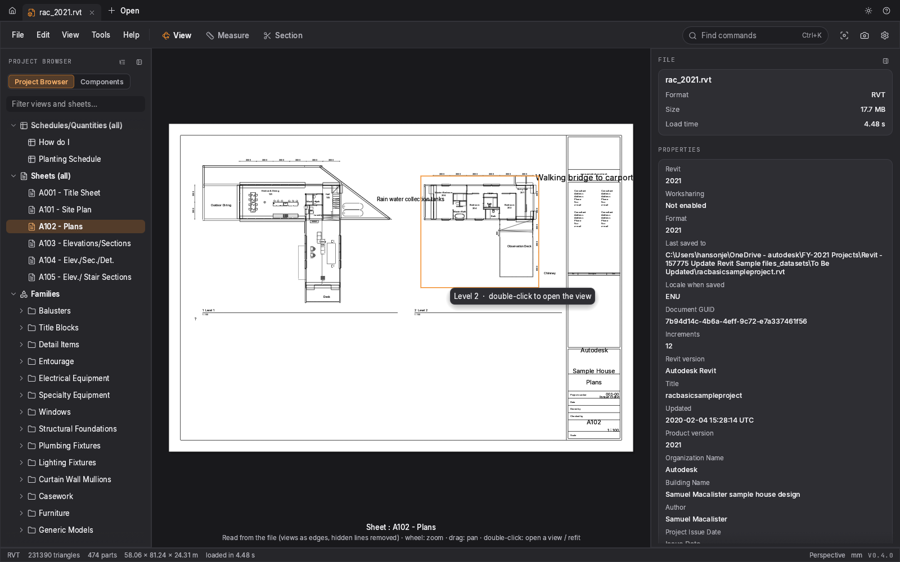
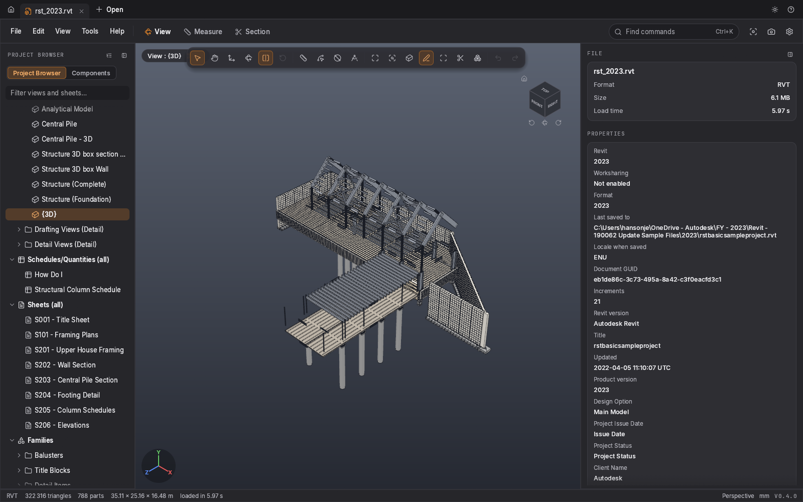
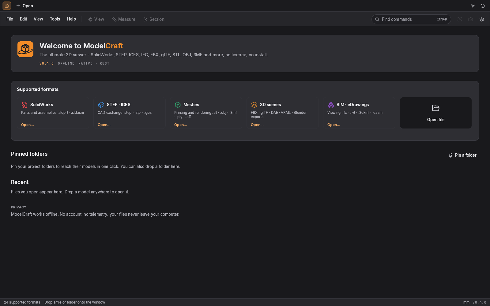

# ModelCraft - the ultimate 3D viewer (V4)

<p align="center"></p>

A native, lightweight, instant viewer for **SolidWorks (`.SLDPRT` / `.SLDASM`), STEP, IGES, IFC,
Revit (`.rvt` / `.rfa`), FBX, glTF/GLB, COLLADA, 3MF, PLY, STL, OBJ, VRML/X3D, USD, 3DS, 3DXML and
eDrawings**, written in Rust (wgpu + egui). One `.exe` (or the `ModelCraft-Setup-0.4.0.exe`
installer), no licence, fully offline. Neither SolidWorks, eDrawings nor Revit needs to be installed.

## Screenshots

All screenshots use **public sample files only** (credits below), in the English interface.

| SolidWorks assembly (`.SLDASM`) | SolidWorks part with measurements (`.SLDPRT`) |
|---|---|
|  |  |
| **STEP assembly (`.STEP`, OpenCascade)** | **IFC building (`.ifc`, web-ifc)** |
|  |  |
| **glTF scene (`.glb`)** | **Revit project, 3D view (`.rvt`)** |
|  |  |
| **Revit title sheet (embedded renderings)** | **Revit plans sheet (views as edges, hidden lines removed)** |
|  |  |
| **Revit structural project, 3D view** | **Home page** |
|  |  |

Sample files (not stored in this repository):
- SolidWorks and STEP: [Mini Bento Arm](https://github.com/BLINCdev/Mini-Bento) by BLINC Lab, CC BY-SA 4.0.
- IFC: *AC20-FZK-Haus* sample house, Karlsruhe Institute of Technology (KIT) IFC examples.
- glTF: *ToyCar* from the [Khronos glTF sample assets](https://github.com/KhronosGroup/glTF-Sample-Assets), CC0 (Guido Odendahl, Eric Chadwick).
- Revit: Autodesk's public sample projects `rac_basic_sample_project` (2021) and `rst_basic_sample_project` (2023).

The interface follows the ArtCraft suite style (layout taken from PdfCraft, MIT/Apache - see
`NOTICE.md`). ModelCraft is an **independent** project, not affiliated with ArtCraft, Dassault
Systèmes or Autodesk.

> ModelCraft depends **on neither SolidWorks nor eDrawings**: it reads the display mesh stored in
> SolidWorks files directly, and uses OpenCascade for STEP/IGES. No eDrawings, SolidWorks or Revit
> code was used.

## Formats

| Format | Extensions | Support | Notes |
|---|---|---|---|
| SolidWorks | `.sldprt` `.sldasm` | ✅ full | stored display mesh, assembly tree, colours; thumbnail when there is no mesh |
| STEP | `.step` `.stp` | ✅ full | via OpenCascade 7.8: surface meshing, assembly tree, colours |
| IGES | `.iges` `.igs` | ✅ full | via OpenCascade |
| IFC (BIM) | `.ifc` `.ifczip` | ✅ full | IFC2x3 / IFC4 / IFC4x3 via web-ifc: levels → elements, colours, transparency (exports from Revit, ArchiCAD, Tekla…) |
| Autodesk Revit | `.rvt` `.rfa` `.rte` `.rft` | ✅ most elements | elements rebuilt from their stored parameters (Revit 2018 to 2026), project browser, sheets and views drawn from the file; see *Known limits* |
| STL | `.stl` | ✅ | binary and ASCII (units: mm) |
| OBJ | `.obj` (+ `.mtl`) | ✅ | groups/objects → components, `Kd` colours, `map_Kd` textures (UV), `vn` normals, concave n-gons |
| 3DS | `.3ds` | ✅ | objects and materials (diffuse colour) |
| 3DXML | `.3dxml` | ✅ | tessellated representations, assemblies |
| FBX | `.fbx` | ✅ | binary and ASCII via assimp: tree, colours, file up axis (no animation) |
| glTF 2.0 | `.gltf` `.glb` | ✅ | nodes, transforms, PBR colours |
| COLLADA | `.dae` | ✅ | file units and up axis |
| 3MF / AMF | `.3mf` `.amf` | ✅ | objects and colours (mm) |
| PLY / OFF | `.ply` `.off` | ✅ | ASCII and binary (mm); point clouds only → clear message |
| VRML 97 / X3D | `.wrl` `.vrml` `.wrz` `.x3dv` `.x3d` | ✅ | built-in VRML reader (DEF/USE, primitives, colours); X3D XML via assimp |
| eDrawings | `.easm` `.eprt` | ✅ | native HOOPS Stream (HSF) reader, no eDrawings needed: meshes, colours, placements, part tree and names |
| USD | `.usd` `.usda` `.usdc` `.usdz` | ⚠️ partial | meshes and transforms (tinyusdz) |
| DXF | `.dxf` | ⚠️ partial | 3D faces and meshes only (no 2D drawings, no ACIS solids) |
| Blender | `.blend` | ⚠️ partial | old 2.7x files only (assimp). **Blender 2.8+: File › Export › Wavefront (.obj) with materials, glTF 2.0 or FBX**, then open the export |
| Others (assimp) | `.x` `.lwo` `.ac` `.ase` `.ms3d` `.md2`… | ⚠️ | via assimp |
| Parasolid | `.x_t` `.x_b` | ❌ | clear message: no free reader - export to STEP |
| DWG / SketchUp / Rhino | `.dwg` `.skp` `.3dm` | ❌ | clear message: LibreDWG is GPL, the SketchUp SDK is proprietary; export to DXF/IFC, DAE/glTF, STEP/OBJ |

### Revit without Revit

`.rvt` and `.rfa` files are read directly (independent reader, see `docs/rvt-rea-notes.md`),
read-only, without locks or synchronisation, workshared or not:
- **Rebuilt 3D shapes** from the parameters stored in the file: straight and curved walls (edited
  profiles, door and window openings), floors, ceilings, slabs, roofs (slopes and layers), stairs
  (runs and landings), railings and balusters, curtain walls (mullions and panels), structural
  framing, columns, footings, rebar, topography, masses, pipes, ducts, cable trays, doors and
  windows sized from their type, and the solids of loaded families (extrusions, revolutions,
  sweeps, blends, nested families). Planting and entourage (picture-based RPC content in Revit)
  are drawn as simple stand-ins (trees, people, cars) fitted to their box.
- **Project browser**: views, sheets, schedules, families. A plan, section, elevation or 3D view
  opens with its direction, crop region and view range, like in Revit.
- **Sheets** drawn flat from the 2D content of the file: title block with filled-in labels,
  revision table, placed views with the edges of the elements they see (hidden lines removed),
  dimensions (linear, radial, angular, spot), hatches, detail lines, text, tags and the embedded
  renderings.

### V4 highlights

**Navigation and tools**
- **Blender shortcuts** by default (*Settings › Navigation › Blender shortcuts*, can be turned
  off): middle click = orbit, `Shift`+middle click = pan, `Ctrl`+middle click = zoom, numpad
  `1/3/7` (+`Ctrl` = opposite view), `5` ortho, `2/4/6/8` = rotate by 15°, `9` opposite view,
  numpad `.` (or `,`) = **frame the selection**, `Home` = frame all, `G` move, `R` rotate,
  middle double-click = frame all. Every shortcut is listed in *Help › Shortcuts*.
- **Pan tool** (hand, `Q`): left click pans the view.
- **Move** (`G`) and **Rotate** (`R`) a part with a gizmo: X/Y/Z arrows, X/Y/Z rings (`Ctrl` =
  15° steps, angle shown), or drag the part to spin it freely. **Reset** puts the selection
  (otherwise everything) back.
- Gizmo **pivot**: bounding box centre (default), object centre, **3D cursor** (`Alt+click` /
  `Alt+drag` to place it on the surface) or world origin.
- **Undo / redo** (`Ctrl+Z`, `Ctrl+Y` / `Ctrl+Shift+Z`): moves, rotations, explode, opacities,
  hide / isolate.
- **Collapsible side panels** (`T` / `N`), state remembered.
- **Synchronised hover** between the 3D view and the tree.

**Display**
- Lighter view (blue-grey background, headlight that follows the camera) with a readable dark theme.
- **Stable edges** from any angle.
- **Exploded view**: each part moves away from the model centre in a straight line, never flips
  direction; also works on a **single-body part** (explode by faces, ≤ 1500 faces). Toolbar button
  + floating 0-100 % panel, discreet explode lines.
- **Turntable** rotation by default (the vertical axis stays vertical); *Settings › Navigation ›
  Rotation*: Turntable or Free (trackball).
- **Readable numbers**: thousands separators and automatic units (`6,115,613.46 mm²` → `6.12 m²`).
- **Missing assembly components**: wider, case-insensitive search (original path, moved project
  tree, then the whole project folder, bounded).

**Formats and installation**
- **Windows installer** (Inno Setup): Start menu, optional desktop icon, one checkbox per file
  extension, clean uninstall.
- OBJ + `.mtl`: opacity, **UV-mapped textures** (`map_Kd`, alpha cut-out), Blender sharp edges,
  concave n-gons triangulated without distortion. A texture referenced by an absolute path from
  another PC (`F:/…/texture.png`) is found next to the `.obj`/`.mtl`.

## Usage (Windows)

**Installer**: run `dist\ModelCraft-Setup-0.4.0.exe` (no admin rights, installed for the current
user). It creates the Start menu entries (ModelCraft + scanner) and offers **one checkbox per
extension** to associate. Uninstall: *Windows Settings › Apps*.

**Portable**: copy `dist\modelcraft.exe` anywhere (e.g. `C:\Tools\ModelCraft\`). No DLLs.

- **Open**: **+ Open** button / `Ctrl+O`, drag and drop (a dropped folder is *pinned* on the home
  page), or `modelcraft.exe "F:\path\part.step"`. Several files open in **tabs** (middle click =
  close; right click = close / reload / show in Explorer / copy path).
- **Home**: supported formats, **pinned folders** (list of the folder's models), **recent files**
  with path and size.
- **File associations**: *Settings → General → File associations → Associate* (or
  `modelcraft.exe --associate`). Adds ModelCraft to "Open with" for the current user (HKCU), no
  admin rights.
- Background loading with a **progress window**: file name and size, step, bytes read, elapsed
  time, **Cancel** button.

### Large files (hundreds of MB)

The SolidWorks loader **streams with bounded memory**:
- the file stays memory-mapped; only the `DisplayLists` stream is read;
- above 128 MB decompressed, it is decoded **straight from the decompressor** in two passes
  (statistics, then building the pre-allocated mesh), never keeping the decompressed stream;
- a **vertex budget** is computed from the available memory (2 M to 40 M); above it the mesh is
  **simplified for display** (vertex clustering) with a warning - the file is never modified;
- allocations are fallible: out of memory gives a clear message instead of a crash.

Measured (synthetic 836 MB file, 60 M vertices, 1.4 GB decompressed): loaded in ~17 s, peak
memory ~1.8 GB (simplified to 12.5 M vertices); ~2.9 GB when displayed exactly.

Environment variables: `MODELCRAFT_MAX_VERTICES=100000000` (vertex budget), `MODELCRAFT_STREAM=1`
(forces streaming decode even for small files).

### Load diagnostics: `--diag`

```powershell
Start-Process -Wait "C:\path\modelcraft.exe" -ArgumentList '--diag','"F:\path\big.SLDPRT"','--diag-out',"$env:USERPROFILE\Desktop\diag.txt"
Get-Content "$env:USERPROFILE\Desktop\diag.txt"
```
Loads the file without a window and writes a timestamped report (flushed line by line, so useful
even after a crash): system, memory, container streams, steps, memory every 2 s, result,
mesh statistics. Default: `%APPDATA%\ModelCraft\diag-<name>.txt`. Exit codes: 0 ok, 1 read error,
2 invalid file, 3 panic. If the application crashes: `%APPDATA%\ModelCraft\crash.log`.

### Assembly tools (viewer only, nothing is saved)

- **Move** a component with the gizmo, reset.
- **Opacity** per component and global, transparent mode.
- **Exploded view** (0-100 % slider, explode lines).
- From the *Assembly* panel, the *Tools* menu, right click and the Ctrl+K palette.

### Menus, palette, context menus

- **File / Edit / View / Tools / Help** menu bar with shortcuts.
- **Ctrl+K**: search palette for every command and the recent files.
- Right click **in the 3D view**: hide / isolate / zoom to selection, show all, fit, standard
  views, measuring tools, projection, edges, box, section, grid, copy dimensions, PNG capture.
- Right click **in the tree**: hide, isolate, show all, zoom to, copy name.

### Measurements (**Measure** mode)

| Tool | Result |
|---|---|
| Bounding box | L × W × H overlay (`B`), copyable (`Ctrl+Shift+C`) |
| Distance | between two points (vertex / midpoint snapping), with ΔX ΔY ΔZ |
| Edge | edge length |
| Diameter | Ø of a hole / cylinder (fitted on the face) |
| Angle | between two faces |
| Face | area of the selected face |
| Volume / area | of the model, in the Dimensions panel |
| Section | adjustable X/Y/Z section plane (`X`) |

### Mouse and keyboard ("Blender" navigation by default, configurable)

| Action | Command |
|---|---|
| Orbit | middle click (or left click) + drag |
| Pan | `Shift`+middle click, right click, or the **Pan** tool (`Q`) + left click |
| Zoom (to the cursor) | wheel (invertible), `Ctrl`+middle click |
| Frame all · frame selection | `Home` / `F` / middle double-click · numpad `.` / `,` |
| Views (numpad or top row) | `1` front · `3` right · `7` top · `Ctrl+1/3/7` opposite · `0` iso · `9` opposite view · `5` ortho · `2/4/6/8` rotate by 15° |
| Move · rotate a part | `G` · `R` (press again to leave), `Ctrl` = 15° steps |
| Undo · redo | `Ctrl+Z` · `Ctrl+Y` / `Ctrl+Shift+Z` |
| Hide / isolate / show all | `H` / `I` or `/` / `Shift+H` or `Alt+H` |
| Edges · box · section · grid | `E` · `B` · `X` · `Shift+G` |
| Tree · info panel | `T` · `P` or `N` |
| Settings · palette · full screen | `Ctrl+,` · `Ctrl+K` · `F11` |

Navigation styles: Blender (default), SolidWorks, CAD (AutoCAD/Inventor).

### Settings (`%APPDATA%\ModelCraft\settings.json`)

- **General**: language **English / Français** (follows the Windows language), light / dark /
  system theme, accent colour, number of recent files, associations.
- **Display**: gradient or plain background, lighting (studio, soft, contrast…), default colour,
  edges (on/off, width, colour), axes, grid, view cube.
- **Navigation**: style, inverted zoom, perspective / orthographic, field of view, default view.
- **Measurements**: units (mm, cm, m, in), decimals.
- **Performance**: MSAA anti-aliasing, STEP/IGES mesh quality.
- **Reset** restores every default.

Command line:
```
modelcraft.exe [files…] [--lang en|fr] [--theme dark|light] [--view iso|front|top|right|back|bottom|left]
               [--size 1600x1000] [--no-edges] [--show view:<name>|measure|settings|…] [--screenshot shot.png] [--ephemeral]
modelcraft.exe --associate
modelcraft.exe --diag file [--diag-out report.txt]
```

## Checking a whole archive: `swcraft-scan`

```
swcraft-scan.exe "F:\Archive" --csv C:\Temp\scan.csv --json C:\Temp\scan.json
```

- Walks the folder recursively and **never writes into it** (read-only, links not followed,
  `~$…` files skipped).
- Every ModelCraft format is checked with the same code as the viewer.
- **Crash-proof**: each heavy or suspicious file is read in a **separate process** (memory limit
  via Job Object, timeout); a reader crash is reported as `crash` and the scan goes on.
- Double-click `swcraft-scan.exe` for interactive mode (asks for the folder).
- Per file: format, `ok`, `partial`, `no_mesh`, `unsupported`, `error` + faces, triangles,
  components, time, message. Summary per format and median / p95 / max time.
- Options: `--threads N`, `--timeout 120`, `--max-size 1G`, `--mem-limit 8G`,
  `--isolate auto|all|none`, `--log file`, `--no-external`, `--quiet`. CSV separated by `;` with BOM.

## Building from source

Requirements: [Rust](https://rustup.rs) ≥ 1.95.

Windows (MSVC or GNU):
```
cargo build --release
target\release\modelcraft.exe
```

Linux:
```
sudo apt install libgtk-3-dev libxkbcommon-dev   # file dialog + keyboard
cargo build --release
./target/release/modelcraft file.SLDPRT
./target/release/swcraft-scan folder/ --csv /tmp/scan.csv
```

**STEP / IGES** need the `occt` feature and a static build of
[OpenCascade 7.8.1](https://github.com/Open-Cascade-SAS/OCCT) (`BUILD_LIBRARY_TYPE=Static`):
```
OCCT_INC=/path/occt/include/opencascade OCCT_LIB=/path/occt/lib \
  cargo build --release -p swcraft -p swcraft-scan --features swcraft/occt,swcraft-scan/occt
```
Without `occt`, ModelCraft works for every other format and shows a message for STEP/IGES.

**FBX, glTF, 3MF…** need the `assimp` feature (static assimp 6.0.2, `ASSIMP_DIR` = install prefix
holding `lib/libassimp.a` and `lib/libzlibstatic.a`, built with
`-DBUILD_SHARED_LIBS=OFF -DASSIMP_BUILD_VRML_IMPORTER=OFF -DASSIMP_BUILD_USD_IMPORTER=ON`).
**IFC** needs the `ifc` feature: web-ifc built statically (`cmake --build <dir> --target web-ifc-library`
with `-DCMAKE_CXX_FLAGS=-Dmapbox=wi_mapbox`), `WEBIFC_SRC=<web-ifc>/src/cpp` and `WEBIFC_BUILD=<build dir>`.
Full example: `--features swcraft/occt,swcraft/assimp,swcraft/ifc,swcraft-scan/occt,swcraft-scan/assimp,swcraft-scan/ifc`.

Cross-compiling Linux → Windows (used for `dist/`, OCCT built with mingw "posix"):
```
rustup target add x86_64-pc-windows-gnu
sudo apt install mingw-w64
CXX_x86_64_pc_windows_gnu=x86_64-w64-mingw32-g++-posix \
OCCT_INC=/path/occt/include/opencascade OCCT_LIB=/path/occt-mingw/win64/gcc/lib \
  cargo build --release --target x86_64-pc-windows-gnu -p swcraft --features swcraft/occt,swcraft/assimp,swcraft/ifc
```
(`.cargo/config.toml` sets the mingw linker and the static CRT; the icon and version info are
embedded with `windres`.)

`scripts/build-release.sh` does all of it: it builds the three native libraries once into `deps/`
(`scripts/build-deps.sh`), then both executables with every format into `dist/`. From Windows,
through Docker:
```
docker build -t modelcraft-cross -f scripts/Dockerfile.cross scripts
docker run --rm -v "%CD%:/src" -v mc-deps:/src/deps -v mc-target:/src/target -w /src modelcraft-cross bash scripts/build-release.sh deps
```

**Windows installer** ([Inno Setup](https://jrsoftware.org/isinfo.php) 6, free) and **portable zip**:
after the Windows build has put both `.exe` into `dist/`,
```
python3 installer/gen_iss.py            # writes installer/modelcraft.iss (extensions from platform.rs, version from Cargo.toml)
iscc installer\modelcraft.iss           # Windows; on Linux: wine "C:\InnoSetup6\ISCC.exe" ...
python3 scripts/package.py              # portable zip
```
produces `dist/ModelCraft-Setup-<version>.exe` and `dist/ModelCraft-<version>-portable.zip`.

**GitHub Actions** (`.github/workflows/ci.yml`): every push runs the tests on Linux and Windows,
then the full Windows build (native libraries cached), the installer and the portable zip, kept
as workflow artifacts. A push to `main` also publishes the release `v<version>` with both files;
bump `version` in `Cargo.toml` for a new release, otherwise the release of the current version is
replaced by the new build.

Diagnostic tool: `cargo run --release -p sw-format --example swinfo -- file.SLDASM [--streams] [--obj out.obj]`.

### Tests

Test files are **not** in the repository (`.gitignore`). Integration tests read the folder given
by `SW_SAMPLES` (and `RVT_SAMPLES` for Revit) and are skipped when it is missing:
```
SW_SAMPLES=/path/to/samples RVT_SAMPLES=/path/to/revit cargo test --release
```
Giant synthetic file for the loader: `cargo run --release -p sw-format --example synth_big -- out.SLDPRT 60`.

## Rendering

wgpu (DirectX 12 / Vulkan / OpenGL depending on the machine), adjustable MSAA, studio lighting,
B-rep edges overlay, gradient background, selection highlight, section plane. If GPU setup fails,
ModelCraft restarts with Vulkan then OpenGL. Force a backend with `WGPU_BACKEND=dx12|vulkan|gl`.

## Known limits (V4)

- **Revit**: shapes are rebuilt from the stored parameters (Revit does not store its B-rep in the
  file), so joins and openings can differ slightly from Revit. Elements whose geometry is not
  stored in a decodable form get the closest stand-in instead of a bounding box: plumbing
  fixtures drawn only as plan symbols (2D lines and filled regions, no solids in Revit either)
  show as 1 cm plates of their filled region stretched over the fixture's footprint; rebar of
  older files with no cached centre lines (Revit 2018) is laid out as straight bars or closed
  ties at the set's bar count, spacing and diameter inside the set's box; stair stringers
  without a stored solid are rebuilt from their path line, width and depth; planting and
  entourage (picture-based RPC) are simple trees, people and cars. Elements that still have no
  shape at all fall back to a bounding box coloured by category (none in the public samples).
  Sheets: model element line weights per category, detail components and calculated tag values
  (area…) are not drawn yet. For the exact geometry, export
  to **IFC** from Revit and open the `.ifc` in ModelCraft.
- **eDrawings `.easm` / `.eprt`**: read natively (clean-room HSF reader written from Tech Soft 3D's
  public format documentation; eDrawings does not need to be installed). Tested with HSF V18.00
  and V19.10 streams (eDrawings 2014 to 2026). Not handled yet:
  Edgebreaker-compressed shells and globally quantized points (not written by the eDrawings
  versions tested), textures (shown with their base colour), 2D drawing sheets, markups and
  embedded OLE pictures;
  stored normals are recomputed; only the first configuration is shown; conditional includes are
  always drawn. An unknown opcode stops the reading and keeps the geometry read so far.
- **Parasolid `.x_t`**: not supported (no free reader); export to STEP. SolidWorks files without a
  display mesh still hold their Parasolid B-rep; an independent XT reader is possible but is weeks
  of work.
- **`MeshData/Config-N-Mesh-*` streams** (mesh bodies of recent SolidWorks files, often the only
  data in very large scan/STL-import files): streamed when `DisplayLists` is empty; only the first
  configuration is read and per-body colours are not applied yet.
- **Blender `.blend`**: old 2.7x files only; export OBJ, glTF or FBX from Blender 2.8+.
- **DWG, SketchUp, Rhino**: not supported (see `NOTICE.md`).
- SolidWorks: only the stored display mesh is used (no B-rep recompute); a file without graphics
  data shows its thumbnail only.
- Some file-reader error messages are still in French in the English interface.
- Measurements on meshes (STL/OBJ/3DS): no exact diameter (no analytic faces).
- No export and no saved annotations: viewer only.

## Licence


MIT for ModelCraft's code. Interface code adapted from PdfCraft (MIT/Apache-2.0), Lucide icons
(ISC), Inter and JetBrains Mono fonts (OFL), OpenCascade (LGPL-2.1), assimp (BSD-3), web-ifc
(MPL-2.0): details in [`NOTICE.md`](NOTICE.md).
